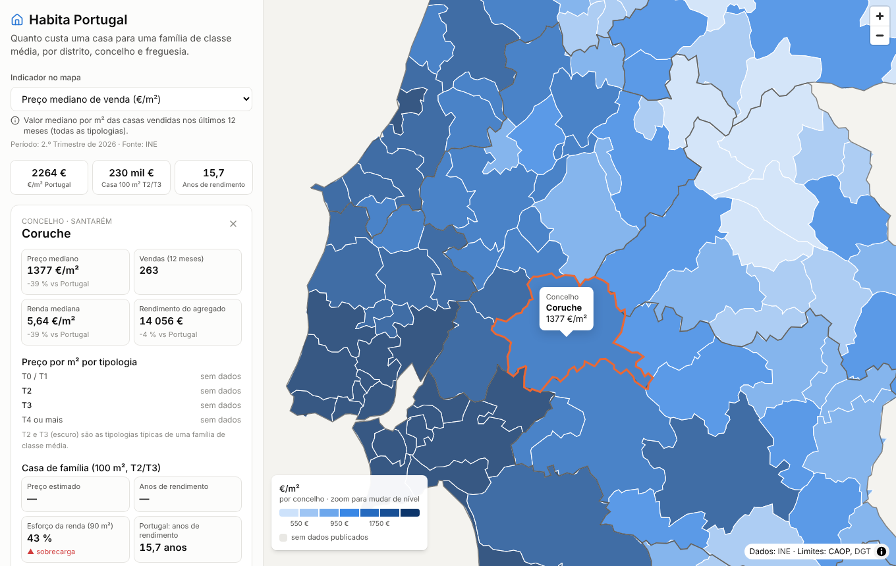

# Habita Portugal



Quanto custa uma casa para uma família de classe média, em cada distrito, concelho e freguesia de Portugal.

Mapa coroplético (MapLibre) com dados oficiais do INE. O nível muda com o zoom:
**distrito → concelho → freguesia**. Clique numa área para ver o detalhe.

## Indicadores

| Grupo | Indicador | Fonte INE (código) | Período |
|---|---|---|---|
| Mercado | Preço mediano de venda €/m² (total, usadas, novas) | 0014763 | últimos 12 meses, trimestral |
| Mercado | N.º de vendas | 0014764 | últimos 12 meses |
| Mercado | Renda mediana €/m² (novos contratos) | 0014773 | anual |
| Casa de família | €/m² de T2 e T3 → preço de uma casa de 100 m² | 0014759 | últimos 12 meses |
| Casa de família | Anos de rendimento para comprar (preço ÷ rendimento mediano do agregado) | 0014759 + 0012712 | |
| Casa de família | Taxa de esforço da renda (T2/T3 de 90 m²) | 0014773 + 0012712 | |
| Oferta | % de casas com 4–5 divisões (≈T2/T3) no parque habitacional | 0014625 (Censos 2021) | 2021 |
| Oferta | % das casas novas concluídas que são T2/T3 | 0013248 | anual |

**Sobre a pergunta "que percentagem das vendas são T2/T3?"** O INE não publica o número de vendas por
tipologia a nível de concelho ou freguesia (só o preço por m² por tipologia, e só onde há vendas suficientes).
Por isso o mapa mostra duas aproximações: o peso dos T2/T3 no parque habitacional (Censos 2021) e nas casas
novas. Ver `docs/ANALISE.md` para alternativas (pedido de apuramento específico ao INE, dados da AT/Portal das Finanças, anúncios).

Notas:
- **Distritos** não são unidade estatística do INE: as somas são exactas; os preços são a média dos concelhos ponderada pelas vendas.
- **Freguesias**: o INE só publica valores onde há vendas suficientes (~300 de 2 873 no continente). Onde não há, o mapa deixa ver a cor do concelho por baixo.
- Onde não há preço por tipologia (fora dos ~55 concelhos maiores), a casa de família usa o preço mediano geral.
- Por agora só o continente. Limites: CAOP (DGT, CC BY 4.0), versão anterior à reorganização de freguesias de 2025.

## Correr localmente

Requer Node.js 20+.

```bash
npm install
npm run dev          # http://localhost:3000
```

Actualizar os dados (descarrega do INE para `.cache/` e escreve `public/data/`):

```bash
rm -rf .cache && npm run data
```

Para um novo trimestre, mude `INE_QUARTER` (ex.: `INE_QUARTER=S5A20263 npm run data`).

## Publicar no Render

`render.yaml` define um site estático: Render → New → Blueprint → escolher este repositório. Sem chaves nem servidor.

## Estrutura

| Parte | Onde |
|---|---|
| Interface (React 19 + Tailwind 4) | `src/App.tsx`, `src/components/` |
| Mapa, camadas por nível de zoom | `src/components/Map.tsx` (limiares em `src/lib/metrics.ts`) |
| Indicadores, textos e formatos | `src/lib/metrics.ts` |
| Classes de cor (quantis, 7 classes, uma cor) | `src/lib/colors.ts` |
| Pipeline de dados | `scripts/build-data.mjs`, `scripts/lib/ine.mjs` (API do INE), `scripts/lib/geo.mjs` (limites, mapshaper) |
